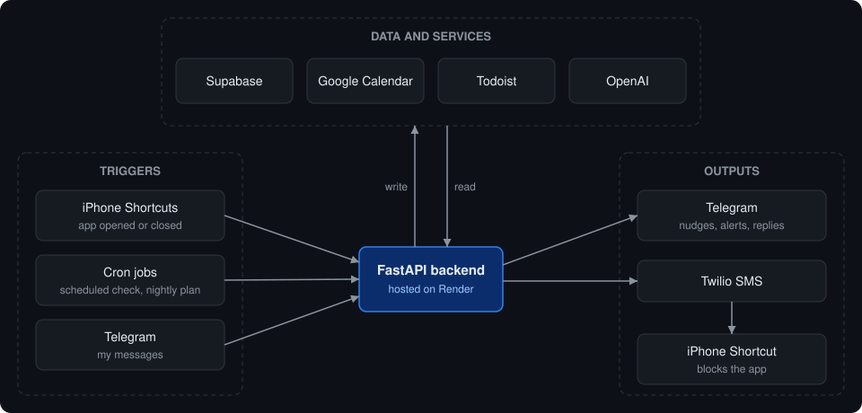

# telegram-personal-assitant-agent

A personal assitant bot that keeps the user on track during the day and plans the next day also. It checks Google Calendar to see what should be done during the day, notices when apps are opened on phones, and calls it out on Telegram. If it keeps getting ignored, it can escalate and send commands that blocks the app.

Each night it builds tomorrow's plan from set tasks on the Todoist app, and can help any time to check the schedule or sort tasks out on Telegram.

> Built for a single user (me) currently. The bot only replies to the Telegram chat ID set in the environment.

## Features

- **App tracking**: iPhone Shortcuts hit an endpoint when YouTube, Chrome, Instagram, Snapchat or Google is opened or closed. Each event gets logged to Supabase.
- **Scheduled check**: a cron job looks at which apps are open and whether there's a calendar block right now, then escalates:
  - Free time, under 5 min: nothing
  - Free time, 5–15 min: Telegram nudge + SMS that opens a Notion page
  - During a block, under 2 min: Telegram nudge
  - Over the limit (15 min free / 2 min in a block): Telegram lock alert + `majorblock` SMS. Resent once if the app is still open 10 min later.
  - Each action fires once per app session, so it doesn't spam.
- **Nightly planner**: around 10pm, if tomorrow has less than 7h scheduled, an LLM fills it with hour-aligned blocks from my p1 Todoist tasks (plus a gym block) and writes them to Google Calendar.
- **Calendar sync**: pulls a day's Google Calendar events into Supabase (adds, updates, deletes).
- **Telegram chat**: talk to it normally. It can sync the calendar, read my schedule, and pull my Todoist tasks. It sees the last ~10 messages from the past 6 hours for context.
- **Message log**: every message in and out is stored in Supabase.

## Architecture

<p align="center">
  
</p>

| Service | Used for |
|---|---|
| Supabase | App activity logs, schedule blocks, messages, assistant actions |
| Google Calendar | Reading today's events, adding planned blocks |
| Todoist | Priority (p1) tasks for the planner and chat |
| OpenAI | Chat agent and nightly planner (`gpt-5-mini`) |
| Telegram | Nudges, alerts and chat replies |
| Twilio | Command texts (`majorblock`, `open-notion-inspo`) that trigger iPhone Shortcuts |

The server doesn't block apps itself. It sends an SMS with a keyword, and an iPhone automation that triggers on that message does the actual blocking.

## Workflows

**Opening an app**
1. Shortcut calls `POST /youtube-opened` (etc.) with the shortcut secret.
2. Server logs an `opened` row to `app_activity_logs`. No message yet.
3. Closing the app logs a `closed` row the same way.

**Scheduled check** (`POST /trigger-scheduled-check`, run by cron every few minutes)
1. Finds the current `schedule_blocks` row, if any.
2. Finds apps whose latest event is `opened` (anything older than 2h is treated as a missed close).
3. Looks at what's already been done this session in `assistant_actions`, then nudges / locks / skips.

**Nightly plan** (`POST /nightly-plan`, ~10pm)
1. Counts hours already on tomorrow's calendar. If 7h or more, stops.
2. Sends today's or tomorrow's blocks plus Todoist tasks to the LLM.
3. Drops anything invalid (wrong day, overlapping), inserts the rest into Google Calendar, then Supabase.
4. Sends me the plan on Telegram.

**Morning sync** (`POST /daily-schedule-download`)
- Makes today's `schedule_blocks` match Google Calendar.

**Telegram**
- `check in` → asks if I finished my current task (Yes/No buttons)
- `notion` → sends my Notion home page as text
- anything else → goes to the chat agent

## Endpoints

| Endpoint | Auth | What it does |
|---|---|---|
| `POST /webhook` | Telegram chat ID check | Telegram messages |
| `POST /{app}-opened`, `/{app}-closed` | `APPLE_SHORTCUT_SECRET` | Log app events. `app` is `youtube`, `chrome`, `ig`, `snapchat`, `google` |
| `POST /daily-schedule-download` | `APPLE_SHORTCUT_SECRET` | Sync today from Google Calendar |
| `POST /trigger-scheduled-check` | `CRON_SECRET` | Run the accountability check |
| `POST /nightly-plan` | `CRON_SECRET` | Plan tomorrow |

Auth is a header: `Authorization: Bearer <secret>`.

App events are ignored outside 6am–midnight, and the scheduled check is skipped outside 8am–midnight (server time).

## File structure

```
backend/
  main.py             FastAPI app and all endpoints
  agent.py            Telegram chat agent (OpenAI + tools)
  schedule_check.py   Nudge / lock logic for the cron check
  planner.py          Nightly planner
  calendar_sync.py    Read/write schedule_blocks, sync from Google
  google_cal.py       Google Calendar auth, read and insert events
  todoist_input.py    Fetch p1 Todoist tasks
  messaging.py        Send Telegram messages, store/load message history
  twilio_actions.py   Send command SMS
  llm_model.py        OpenAI client + a nudge generator (not wired up right now)
  database_conn.py    Supabase client
  requirements.txt
```

## Environment variables

| Variable | Used for |
|---|---|
| `TELEGRAM_TOKEN` | Bot token from BotFather |
| `TELEGRAM_CHAT_ID` | My chat ID. The bot ignores everyone else |
| `OPENAI_API_KEY` | Chat agent and planner |
| `SUPABASE_URL` | Supabase project URL |
| `SUPABASE_PUBLISHABLE_KEY` | Supabase key |
| `GOOGLE_CLIENT_ID` | Google OAuth (local login) |
| `GOOGLE_CLIENT_SECRET` | Google OAuth (local login) |
| `GOOGLE_TOKEN_JSON` | Contents of `token.json`, for the server |
| `TODOIST_API_TOKEN` | Todoist API |
| `ACCOUNT_SID` | Twilio account SID |
| `AUTH_TOKEN_TWILIO` | Twilio auth token |
| `TWILIO_NUM` | Twilio number that sends the SMS |
| `RECEIVING_NUM` | My phone number |
| `APPLE_SHORTCUT_SECRET` | Auth for the Shortcut endpoints |
| `CRON_SECRET` | Auth for the cron endpoints |
| `NOTION_API_KEY` | The `notion` Telegram command |
| `SYSTEM_PROMPT` | Prompt for the nudge generator (optional, currently unused) |
| `RENDER` | Set automatically on Render. Stops it from trying a browser login on the server |

## Setup

This isn't a one-command install. The bot relies on accounts with Telegram, OpenAI, Supabase, Google, Todoist and Twilio, plus an iPhone for the Shortcuts. Once those exist, setup takes four steps.

**1. Install and configure** (Python 3.10+)

```bash
cd backend
pip install -r requirements.txt python-dotenv
```

Put the [environment variables](#environment-variables) in `backend/.env`.

**2. Create the database tables** in Supabase (see the table list below).

**3. Connect Google Calendar**

```bash
python google_cal.py
```

This opens a browser to log in, saves `token.json` and prints today's events. When you deploy, paste the contents of `token.json` into `GOOGLE_TOKEN_JSON`.

**4. Run it and connect Telegram**

```bash
uvicorn main:app --reload --env-file .env
curl "https://api.telegram.org/bot<TELEGRAM_TOKEN>/setWebhook?url=https://<your-server>/webhook"
```

Telegram needs a public URL, so deploy it (e.g. Render) or use a tunnel like ngrok when running locally.

<details>
<summary><b>Supabase tables</b></summary>

There are no migrations in the repo, so create these yourself:

| Table | Columns |
|---|---|
| `app_activity_logs` | `app_name`, `event_type`, `timestamp` |
| `schedule_blocks` | `id`, `google_event_id` (unique), `title`, `start_time`, `end_time`, `updated_at` |
| `messages` | `id`, `role`, `content`, `message_type`, `related_app`, `schedule_block_id`, `metadata`, `sent_at` |
| `assistant_actions` | `triggered_at`, `acted_at`, `trigger_type`, `trigger_name`, `trigger_data`, `action_taken`, `escalation_stage`, `reason`, `related_app`, `schedule_block_id`, `message_id`, `action_meta` |

</details>

<details>
<summary><b>Cron and iPhone automations</b> (needed for tracking and planning)</summary>

- **Cron**: anything that can send a POST with a header works (cron-job.org, Render cron). Call `/trigger-scheduled-check` every few minutes and `/nightly-plan` once around 10pm.
- **iPhone**: add Shortcuts automations that POST to the `-opened` and `-closed` endpoints when each app opens and closes, plus automations that run when an SMS containing `majorblock` or `open-notion-inspo` arrives.

</details>

## Notes

- Times use the server's local time zone. On Render that's UTC, so the active-hours windows and "today" are in UTC.
- The Notion page ID is hardcoded in `main.py`.

